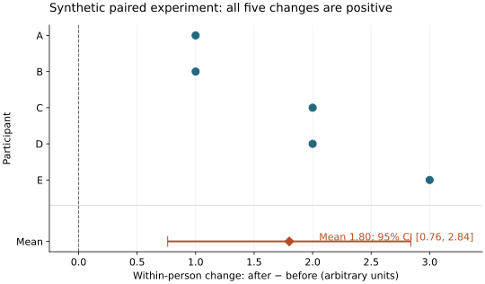

# Blind workflow trial

An independent agent completed a five-person synthetic paired analysis using the original copied skill bundle.
Mean change was **1.8 arbitrary units**, with a 95% t interval of **0.761–2.839**.
The figure and interpretation agree with an independently calculated known answer.

The SVG is an unchanged copy from the [completed task](https://github.com/leej3/stamped-ai-research-next/tree/codex/proof-skill-followability/results); its source identity and hash are in [record.json](record.json).

## What completed

The worker produced community-package analysis, executable Pixi tasks, a native DataLad run, complete task-local duct records, a separate exact-lock snapshot, and an inspected figure.
A fresh local recipient retrieved ten initially absent annex payloads and genuinely regenerated five scientific artifacts with identical SHA-256 hashes.
Independent grading passed [32 checks](grading.json), including the known-answer arithmetic and seven rejected invalid-input cases; the grader inspected the existing delivery/rerun evidence rather than repeating those transfers.

- [Task history](https://github.com/leej3/stamped-ai-research-next/tree/codex/proof-skill-followability): `9c15dfe23eb8ad03ac6420f381ca645a6c3dddda`.
- [Exact environment](https://github.com/leej3/stamped-ai-research-next/tree/codex/env-skill-followability): `472fbcfdcde21a4120a29ee2e6e3b13d8e72f67c`.
- [Native replay](https://github.com/leej3/stamped-ai-research-next/tree/codex/proof-skill-followability-rerun): `4956203d524b814e416e87260ce4d1ae82ac176e`.

## What needed repair

The worker encountered the wheel's minimum macOS version, missing MagicMime support, and conflicting guidance about where logs belong.
These observations informed concise resource-skill corrections.
The first delivery attempt used an abbreviated Git object ID and failed; the full-ID retry succeeded.
Both attempts remain in [delivery-failed](delivery-failed/) and [delivery](delivery/).
[Quoted friction](delivery/trial-friction.md) and its [classification](friction-classification.json) distinguish instruction gaps, collector limitations and worker error.

The [exact prompt](prompt.md), [36-file instruction snapshot](source-snapshot/), [hash manifest](snapshot-sha256.json), [grader](grade.py) and [self-assessment](self-assessment/) are retained.
The worker kept its original instruction snapshot throughout; later corrections are not credited as part of its initial condition.
The coordinator waived an additional scientific reviewer for this known-answer trial; independent numerical checks and this separate grading remain distinguishable.

This demonstrates followability on one bounded same-host task.
It does not establish skill efficacy, efficiency, ReproNim/Entire behavior, cluster execution or portability to another platform.
The original worker's distribution check was local; later publication by the coordinator is separate evidence.
