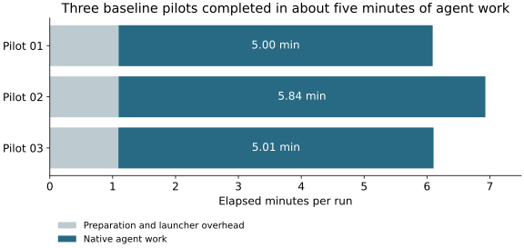

# NARPS suitability pilots

Three independent baseline agents completed the prepared participant-map task in 5.00, 5.84 and 5.01 minutes of native agent work.
This is a useful compact test of scientific decisions and reproducibility; it does not demonstrate a 30–45 minute workload or an effect of STAMPED skills.
All three ran concurrently with Luna/high, identical prompts, the same 54 maps and common environment, without supplied research skills or previous results.
The pinned coordinator was `945f6e7` and study `a36fb10`; exact identities and measurements are in [comparison.json](comparison.json).

Preparation and launcher overhead added about 66 seconds per run.
Native agent time includes research, coding, commands and reporting; it is not analysis-only computation.
Later coordinator retention, publication, assessment and review work is excluded from these timings.
Aggregate CPU time was 63, 207 and 161 seconds, and maximum process RSS was 1.10, 5.71 and 1.70 GB.
Those resource measurements cover setup, the CLI and descendants; analysis-only measurements were not recorded.
Concurrent runs shared a 10-logical-CPU Apple M4 with 32 GiB memory.

| Pilot | Whole-brain correction | vmPFC definition | Mask | Positive corrected voxels, whole brain / vmPFC |
| --- | --- | --- | --- | --- |
| [01](https://github.com/leej3/stamped-ai-research-next/tree/510a685426804385a8c80f6347002ee47ce606e9) | Bonferroni | Harvard–Oxford medial frontal atlas proxy | Complete common support | 11 / 0 |
| [02](https://github.com/leej3/stamped-ai-research-next/tree/466d43f39dc3d40ac64038ff03066b483b6d9457) | 10,000 max-t sign flips | 15 mm sphere at MNI (0, 40, −10) | At least 90% coverage | 24 / 0 |
| [03](https://github.com/leej3/stamped-ai-research-next/tree/f711558b2e29c376410e0e622b2f2a992f77bb41) | 9,999 max-t sign flips | Broad MNI coordinate box | Complete common support | 24 / 0 |

Each produced three figures, quality checks, uncertainty estimates, code and a report.
Figure quality varied: pilot 03's corrected-result plot lacks an anatomical background, making its sparse voxels difficult to locate despite the reported coordinates.
All reported no whole-brain-corrected positive vmPFC finding and distinguished lack of support from evidence of absence.
Their anatomical definitions and correction methods differ, so agreement is not independent scientific validation.
Pilot 02's coverage mask admits unavailable zero-valued observations, then includes them in means and standard deviations with all 54 participants; this warrants review before relying on its inference.
We preserved that result unchanged.

The agents worked through ordinary software failures without coordinator hints.
Pilot 02 detected and repaired an incorrectly scaled permutation statistic and a rerun blocked by locked annex outputs.
No worker committed its research outputs; the coordinator saved unchanged scientific artifacts first, then added execution and publication receipts separately.
No additional scientific repair or independent replay is claimed here.

The useful skill-development questions are whether guidance improves coverage handling, validates custom inference against established implementations, makes anatomical choices and figures informative, and leaves a readily replayable research object.
These are candidates for testing, not demonstrated skill improvements.
Keep this descriptive preparation sample separate from the later four-condition comparison.

## STAMPED assessments

Each link opens a short index with a clickable filled checklist, reviewed report and original independent judgment.
All use checklist 0.3.1 and assessor source `d867c1d`; the initial judges used Luna/high and the explicitly labeled coordinator review used Astra/ultra.

| Pilot | Reviewed checklist and reports | MUST met / partial / unmet |
| --- | --- | --- |
| 01 | [Open checklist index](https://github.com/leej3/stamped-ai-research-next/blob/699deea221a88c49543288d7e6533fee9a929f4a/execution/assessment/README.md) | 10 / 4 / 3 |
| 02 | [Open checklist index](https://github.com/leej3/stamped-ai-research-next/blob/46f2e86cd228bb05118c37c57560495d41cde114/execution/assessment/README.md) | 10 / 2 / 5 |
| 03 | [Open checklist index](https://github.com/leej3/stamped-ai-research-next/blob/f20351ddd4c0af7c1166c3ef93d693af9eeda723/execution/assessment/README.md) | 10 / 3 / 4 |

Partial does not satisfy a MUST; these are item counts, not overall scores.
Fresh scientific replay remains `not-checked` under SHOULD; no scientific validity conclusion follows from checklist attainment.
Review corrected a missed external atlas, a bundled template mistaken for a download, an inverted Pixi warning and a dependency-inclusion item incorrectly graded for missing exact versions.
Initial judgments and before/after ledgers remain intact; reviewed revisions are not additional independent judges.
Later coordinator packaging and lock snapshots do not earn credit for the original worker objects; current accessibility is reported separately from worker publication behavior.

## Retention

Each run is retained as an experiment submodule under the study's `results/`, uninitialized until selected.
Its exact scientific commit remains distinct from later evidence packaging and its final environment snapshot.
Independent GitHub/CON Hub retrieval verified the published artifacts and final locks; hosted Entire checks matched all three intended worker sessions. Exact checkpoint IDs, verification commands and receipt links are in [comparison.json](comparison.json); final publication receipts are retained under [publication/](publication/).
Recreate the timing figure with `pixi run python iterations/2026-10-15-narps-suitability/plot.py`.
