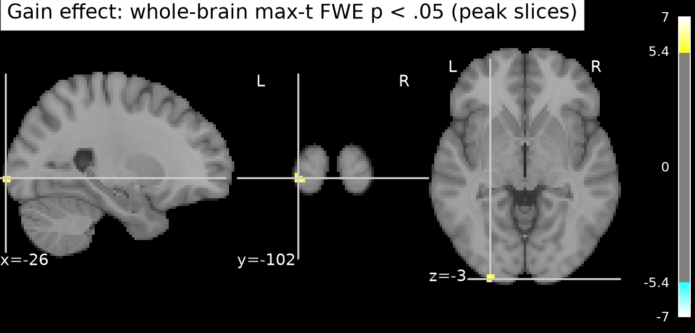
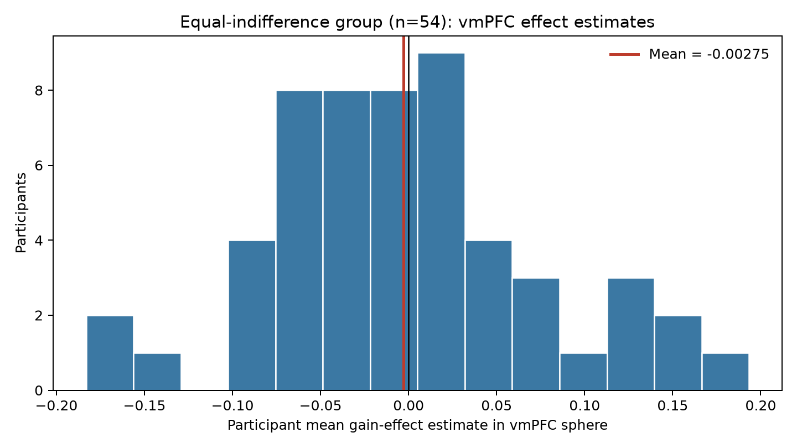
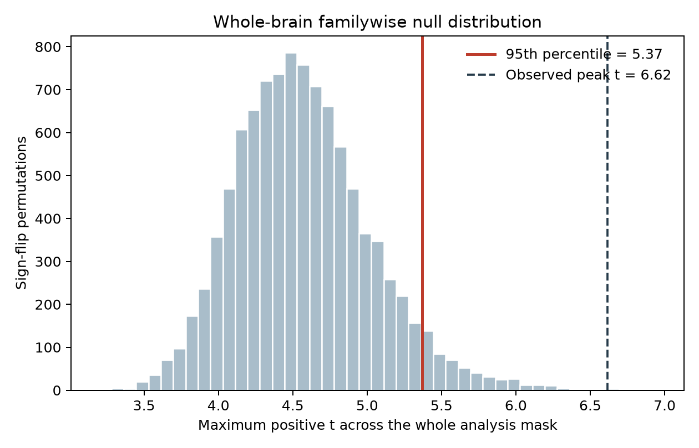

# Potential gain and vmPFC response: NARPS equal-indifference group

## Result

**This analysis does not support a greater vmPFC response with increasing potential gain.** In a prespecified 15 mm MNI-space sphere centered at (0, 40, −10), the across-participant mean gain-effect estimate was −0.0027 (SD 0.0786; 95% CI −0.0242 to 0.0187; one-sided sign-flip *p* = .607). The highest voxel in this sphere was not significant after whole-brain correction (*t* = 3.15, max-*t* FWE *p* = 1.00).

The whole-brain test did find 24 voxels with positive effects surviving one-sided familywise correction (*p*FWE < .05; max-*t* threshold = 5.37). The peak was *t*(53) = 6.62, max-*t* FWE *p* = .0008 at MNI (−26, −102, −3.6), a posterior location outside vmPFC. Thus, the corrected whole-brain result does not support the stated vmPFC hypothesis. The posterior signal is not interpreted as evidence for the vmPFC prediction.

## Group analysis

The analysis used the 54 supplied unthresholded AO86 gain-effect maps for equal-indifference participants. I tested whether the participant-level coefficient estimates had a positive group mean at each voxel with a one-sample *t* statistic (df = 53). The directional test matches Hypothesis 1. Whole-brain familywise error was controlled at .05 using 10,000 participant-level sign-flip permutations and the maximum positive *t* over the analysis mask. This gives a nonparametric whole-brain correction without relying on a smoothness estimate. The original instructions ask teams to make the hypothesis decision from a whole-brain corrected analysis, rather than an ROI-only result ([NARPS analysis instructions](https://www.narps.info/files/narps_instructions_for_analysis_teams.pdf)). The implementation uses Python 3.13.16, NumPy 2.5.4, SciPy 1.18.1, nibabel 5.4.2, and nilearn 0.14.1.

The supplied inputs did not include a vmPFC atlas mask. For an explicit and reproducible anatomical target, I defined vmPFC as a sphere of radius 15 mm centered at MNI (0, 40, −10), covering medial orbital/ventromedial prefrontal cortex. This ROI was specified independently of these effects and used to summarize the target location; it did not replace the whole-brain corrected test. A different vmPFC boundary could change a regional summary, so the sphere definition is part of the result.

## Quality checks and exclusions

All 54 participant IDs matched the metadata, all maps had matching 97 × 115 × 81 geometry and affine, all values were finite, and every retrieved file matched its source-manifest SHA256 checksum. No participants were excluded. The analysis mask comprised 210,968 voxels with nonzero map coverage in at least 90% of participants. The coverage threshold was based on map availability, not effect direction or statistical significance. Individual nonzero coverage ranged from 24.1% to 25.7% of the image volume. Per-map checks are in [`quality_checks.tsv`](quality_checks.tsv).

## Interpretation and limits

The group estimate and interval summarize the supplied first-level gain-modulator coefficients, not standardized effects or BOLD change per unit of money. Upstream, the gain regressor was mean-centered and variance-normalized before HRF convolution, so its coefficient cannot be read as response per dollar. It was also modeled separately from loss, with response-time durations and response-choice/gain modulators in the stated design. The estimate is conditional on those fixed modeling choices. Although potential gain spanned twice the loss range in this group, these maps do not estimate a direct gain-versus-loss contrast.

The second-level analysis treats participant coefficient estimates equally. Participant variance maps were unavailable, so a precision-weighted mixed-effects model could not be fit. The sign-flip test assumes participant effects are exchangeable and their null distribution is symmetric; 10,000 random permutations also give finite Monte Carlo precision. No corrected vmPFC finding is not proof of no gain-related response: the interval remains compatible with small positive and negative coefficients, and upstream estimation error or a different anatomical vmPFC definition may matter. It means this supplied group analysis did not provide whole-brain-corrected evidence for the predicted positive vmPFC effect.

## Reproducibility

Run `pixi run python results/analysis.py` from the experiment root. The script, fixed random seed, summary JSON, unthresholded group maps, corrected *p* map, thresholded *t* map, and participant-level vmPFC estimates are included in `results/`. `run.log` retains the successful execution log. Group map values use the fixed upstream effect estimates; no time-series scans or upstream preprocessing were used.
