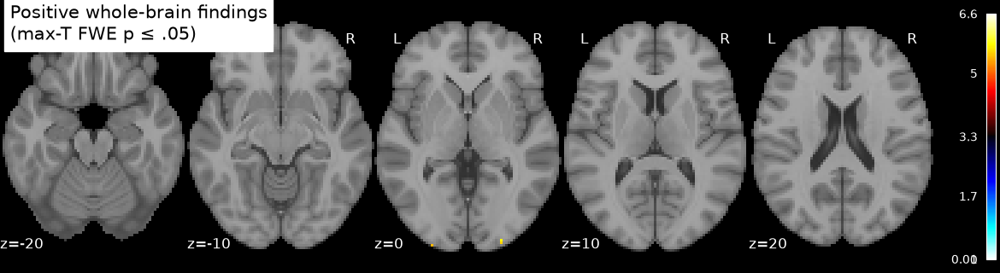
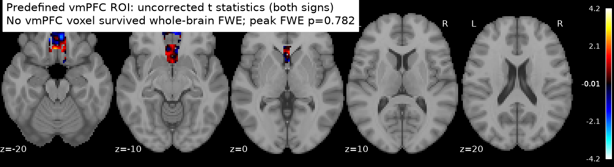
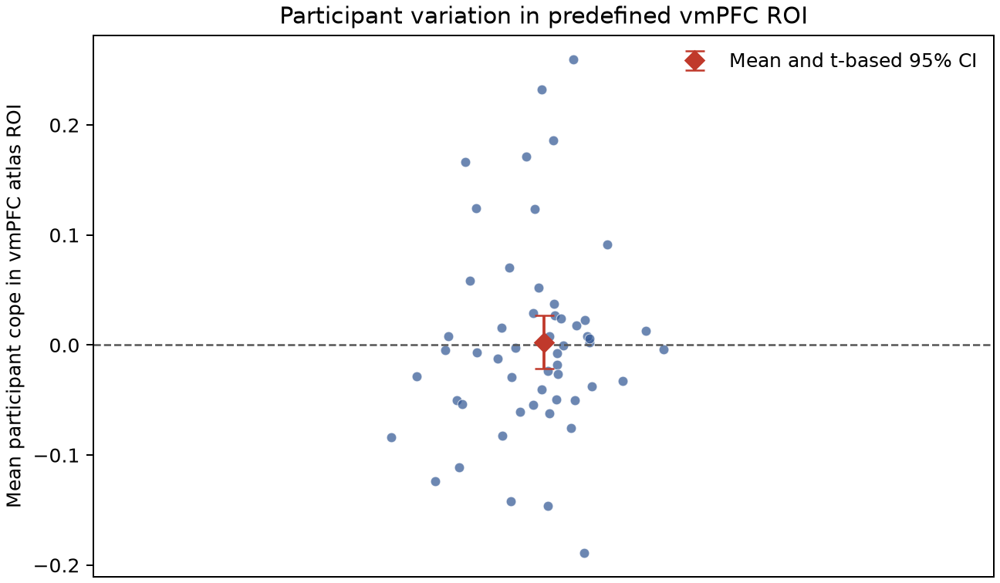

# Potential gain response in the NARPS equal-indifference group

## Result

The supplied data do **not** support a positive vmPFC response to potential gain under whole-brain family-wise error (FWE) correction. In the 54 supplied equal-indifference participants, no positive vmPFC voxel survived the prespecified one-sided whole-brain max-statistic test (0/1,422 vmPFC voxels; best vmPFC voxel at MNI [−2, 24, −18], *t*=4.19, FWE *p*=.782).

As a regional summary, the mean participant cope averaged over a predefined vmPFC atlas mask was 0.0027 (t-based 95% CI −0.0217 to 0.0270; participant-bootstrap 95% CI −0.0200 to 0.0261). The interval includes zero and modest positive and negative values. These are cope units, **not** BOLD change per currency unit.

The whole-brain test did find 24 positive FWE-significant voxels, in three small descriptive occipital components, rather than vmPFC. The largest component had 17 voxels and a peak at MNI [−26, −102, −3.6] (*t*=6.62, voxelwise FWE *p*=.0007); the other peaks were [30, −94, −8.4] (*t*=6.19, *p*=.0024; 5 voxels) and [26, −98, −1.2] (*t*=5.76, *p*=.0135; 2 voxels). Component sizes are descriptive only; the correction was voxelwise max-*t*, not cluster-extent inference.

## Analysis

The original NARPS Hypothesis 1 predicts a positive parametric gain effect in vmPFC for the equal-indifference group ([original analysis instructions](https://www.narps.info/files/narps_instructions_for_analysis_teams.pdf)). I tested the positive group mean of the supplied participant-level gain contrast parameter estimates using a one-sample *t* statistic and 9,999 participant-level random sign flips. The maximum positive *t* over the whole search mask controlled voxelwise FWE at .05; corrected *p* values use the add-one permutation estimate. The seed is 20261015.

The search family was the intersection of finite, nonzero support across all maps: 198,029 voxels (about 1.90 L). The vmPFC localization mask was defined before looking at the group result as the union of the Harvard–Oxford cortical max-probability 25% labels “Frontal Medial Cortex” and “Subcallosal Cortex,” nearest-neighbor resampled to the input image grid (1,422 search-mask voxels). This broad anatomical proxy makes localization explicit without restricting whole-brain correction. Harvard–Oxford is a structural atlas with probabilistic source regions ([FSL atlas documentation](https://fsl.fmrib.ox.ac.uk/fsl/docs/other/datasets.html)); vmPFC boundaries vary across studies.

All 54 metadata IDs matched a unique supplied map; file byte counts and SHA-256 checksums matched `input/sources.json`. Maps shared a 97×115×81 grid and affine. No participants were excluded, and no exclusions were based on observed effects. The full integrity record is `pilot-qc.json`.

## Interpretation and limits

The upstream gain regressor was mean-centered and variance-normalized before HRF convolution, and the supplied values are unthresholded participant cope estimates averaged across four runs. They are neither standardized test statistics nor slopes per unit of money. Gain and loss were modeled separately upstream, so this effect is conditional on that first-level model; the gain range being twice the loss range does not convert the cope into a currency-scaled response. The fixed upstream choices and their limits are documented in [`upstream-methods.md`](../input/upstream-methods.md).

Participant variance maps are not supplied, so a precision-weighted mixed-effects group model cannot be reconstructed. The equal-weight one-sample model estimates the group mean and uses the between-participant spread for its *t* statistic; permutation validity depends on participant-level exchangeability and a symmetric zero-centered null. The atlas overlay is an anatomical aid, not a functional localizer. The standard MNI152 template is used only as a figure background.

No corrected vmPFC finding means this analysis did not meet the prespecified evidential threshold for the hypothesis. It does not establish that the vmPFC effect is zero: the regional interval still allows modest effects, and cope-only group inference is limited by absent first-level variances. A different result would require new evidence or a justified model/data revision, not treating an uncorrected vmPFC peak as confirmation.

## Reproduction and artifacts

From the repository root, run `pixi run recorded-analysis` to regenerate statistical maps, summaries and figures with duct capture and a run-provenance record, or `pixi run validate` for independent checks against SciPy and the saved max-statistic null distribution. The final recorded run is `20261015T233701Z`; its duct files and provenance are `logs/20261015T233701Z-*`. Earlier failed attempts are retained in `logs/` with their error output. The max-*t* null distribution is `permutation-max-t.tsv`.

The analysis ran with Python 3.13.16, nibabel 5.4.2, nilearn 0.14.1, NumPy 2.5.4 and SciPy 1.18.1. Its code revision was `6750b00`; the locked environment was `pixi.lock` SHA-256 `5884bb53a343659adce7759c1b48477e2cdffb71b4838e49d14810e75dc75f21`.

A fresh checkout at `bf5308d` restored the locked Pixi environment, retrieved the annexed cope maps from the local Git origin, removed generated outputs, reran `recorded-analysis` and the input pilot, then compared all 15 generated result artifacts against the baseline manifest. Every file was byte-identical (`logs/replay-compare-final-20261015-*`). This was a same-host replay; the Nilearn template cache was already present, while the Harvard–Oxford atlas was fetched into the experiment's `results/atlas-cache`. No time-series scans were fetched.
