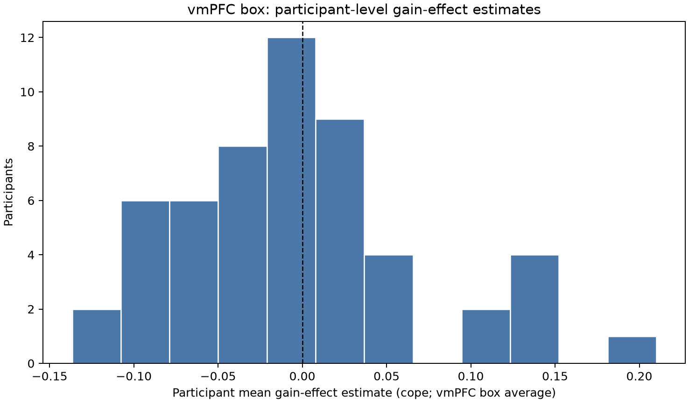
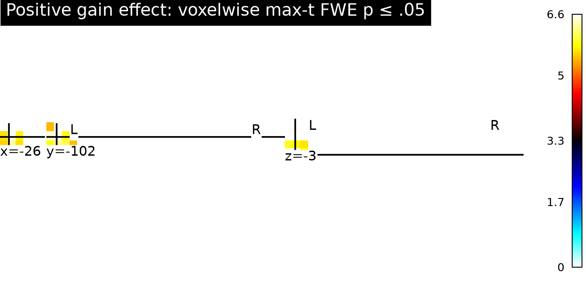
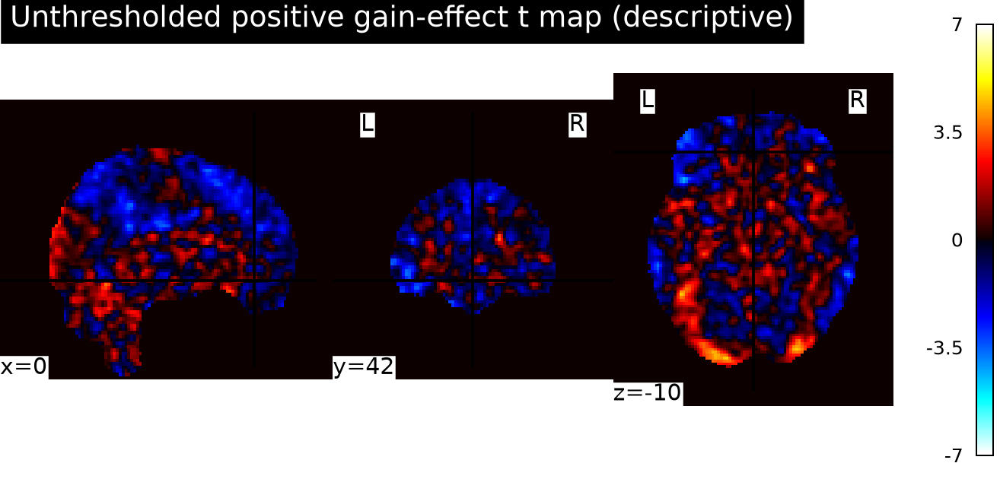

# Potential monetary gain and vmPFC activity

## Conclusion

These maps do **not support a positive gain effect in vmPFC** in the NARPS equal-indifference group at the required whole-brain corrected threshold. In the broad MNI vmPFC localization box, the mean participant effect was −0.0029 cope (95% CI −0.0225 to 0.0168); its largest positive voxel was *t*(53) = 3.92 at MNI [−2, 26, −18], with one-sided whole-brain max-*t* FWE *p* = .937. No vmPFC-box voxel survived correction.

A separate positive result occurred in posterior/inferior locations: 24 voxels survived whole-brain correction, with the maximum at [−26, −102, −3.6], *t*(53) = 6.62, FWE *p* = .0007. This does not establish the hypothesized vmPFC response. It is an unexpected whole-brain finding and should be treated cautiously.

## Analysis

We analyzed the 54 supplied unthresholded AO86 participant gain-effect maps for the complete equal-indifference cohort. We did not repeat preprocessing or participant modeling. All map checksums matched the supplied source metadata; all images were finite and had matching shape and affine. All 54 participants were retained, with no exclusions.

We fit an intercept-only one-sample group model at each voxel and tested the stated positive direction with a participant-level sign-flip maximum-*t* procedure (9,999 random sign patterns; seed 20261015). The maximum statistic across the common-support analysis mask controls familywise error across the whole brain. The mask included the 198,029 voxels with nonzero data in every participant map, avoiding treating uncovered voxels as zero-valued measurements. The directional test follows the hypothesis; the original [NARPS analysis instructions](https://www.narps.info/files/narps_instructions_for_analysis_teams.pdf) require hypothesis decisions based on whole-brain corrected analysis.

Because no vmPFC atlas mask was supplied, we localized vmPFC using a broad, fixed MNI coordinate box (x −15 to 15, y 25 to 65, z −25 to 5 mm), covering ventromedial/orbitomedial prefrontal territory. This box was defined independently of the observed maps. It was used only to identify whether whole-brain-corrected voxels fell in the hypothesized region; no uncorrected or small-volume result was used to claim support.

## Interpretation and limits

The upstream gain regressor was mean-centered and variance-normalized before HRF convolution. Therefore these cope estimates describe BOLD response associated with a standardized gain modulator under the stated first-level model; they are not slopes per dollar or direct estimates of the causal effect of changing a gamble's currency amount. Gain and loss were modeled separately, and the gain effect is conditional on that modeling choice and the other upstream regressors.

The vmPFC interval includes zero and both modest negative and positive effects. Failure to detect a corrected vmPFC response is not evidence of equivalence or proof that vmPFC does not encode gains. It means these group maps do not provide sufficient whole-brain-corrected evidence for the stated vmPFC hypothesis. The 54-person group, noisy first-level estimates, and stringent whole-brain correction may limit sensitivity.

Participant variance maps were not supplied, so the group model is unweighted and cannot model first-level precision differences. The randomization test assumes participant effects are exchangeable and symmetric under the zero-effect null. The common-support mask is data-derived from the supplied maps. The coordinate box is an approximate anatomical operationalization rather than a probabilistic atlas ROI. Upstream model choices are fixed inputs and cannot be independently audited from these maps alone.

## Figures

**Figure 1.** Distribution of participant mean cope averaged across the vmPFC localization box. The dashed line marks zero.

**Figure 2.** Positive voxels surviving one-sided whole-brain maximum-*t* FWE correction at .05. The slices pass through the whole-brain maximum in posterior/inferior locations; they are not vmPFC slices.

**Figure 3.** Unthresholded positive-direction *t* map, shown at vmPFC localization coordinates for descriptive context only.

## Reproducibility and outputs

Run from the experiment root with `pixi run python results/code/group_analysis.py`. The script checks cohort membership, image grid, finite values, and SHA256 checksums, then writes the group maps, summary JSON, participant QC table, and figures under `results/`. The run used Python 3.13.16, NumPy 2.5.4, SciPy 1.18.1, pandas 3.0.6, Matplotlib 3.11.2, nibabel 5.4.2, and Nilearn 0.14.1 from the Pixi lockfile. Main results are in [`group_summary.json`](tables/group_summary.json); participant checks are in [`participant_qc.csv`](tables/participant_qc.csv). The analysis code is [`group_analysis.py`](code/group_analysis.py). Logs, including the retained initial plotting-library failure, are under `logs/`.
