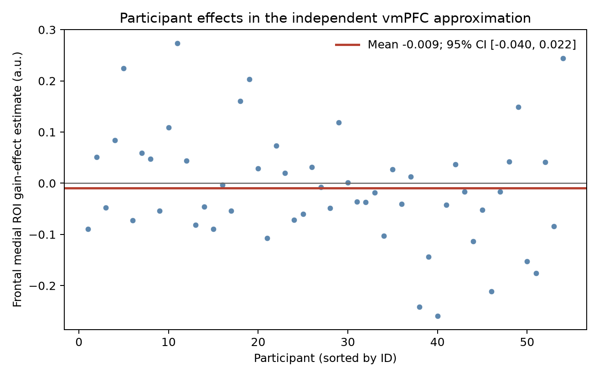

# Potential gains and brain activity in NARPS equal-indifference participants

## Conclusion

The supplied gain-effect maps do **not support the predicted positive vmPFC response** under the prespecified whole-brain criterion. In an independent Harvard–Oxford Frontal Medial Cortex approximation to vmPFC, the mean participant effect was slightly negative (mean = −0.009 upstream units; 95% t interval −0.040 to 0.022; *n* = 54). No positive voxel in this region survived whole-brain family-wise error (FWE) correction. This is not evidence that the true effect is zero: the interval includes small positive and negative effects, and the analysis has no equivalence bound.

Eleven positive voxels survived the whole-brain test, but they were all posterior (most near MNI [−26, −102, −3.6]) and outside the vmPFC approximation. They form small foci at the posterior/inferior edge of the analyzed volume and do not establish the vmPFC hypothesis. Treat their location as exploratory.

## Analysis and operational definitions

I analyzed all 54 equal-indifference participants with a one-sample random-effects *t* model of their participant-level gain contrast estimates. The directional test was positive (one-sided), matching NARPS Hypothesis 1. The analysis mask was the intersection of nonzero voxels across all 54 maps (198,029 voxels; 1,901 ml on the supplied 2 × 2 × 2.4 mm grid); no participant was excluded. The whole-brain family-wise criterion was Bonferroni *p* < .05 over every voxel in this mask. This is valid and conservative, and avoids relying on an uncorrected ROI test. The minimum corrected *p* was 0.00184; 11 voxels passed.

Because vmPFC has no single agreed anatomical boundary, I used the Harvard–Oxford cortical structural atlas's **Frontal Medial Cortex** max-probability label at the 25% threshold (769 voxels in the group mask; 7.38 ml) as an independent, reproducible approximation. The label is an anatomical proxy, not a claim that all its voxels are functionally vmPFC; the NARPS literature also notes variability in teams' operational definitions of vmPFC. The ROI summarizes the estimate and localizes the whole-brain result. Hypothesis support still required a positive whole-brain FWE-significant voxel to overlap this ROI.

| Measure | Result |
|---|---:|
| Participants included / excluded | 54 / 0 |
| Whole-brain mask | 198,029 voxels |
| Positive whole-brain voxels, Bonferroni FWE *p* < .05 | 11 |
| Peak positive voxel | *t*(53) = 6.62 at MNI [−26, −102, −3.6] mm |
| vmPFC-proxy mean participant effect | −0.009 upstream units |
| vmPFC-proxy 95% t interval | [−0.040, 0.022] |
| vmPFC-proxy positive one-sided *p* (descriptive only) | .723, uncorrected |
| Positive FWE voxel in vmPFC proxy | No |

The ROI interval is a participant-level *t* interval for the average ROI effect; the uncorrected ROI *p* is descriptive and was not used to declare support. Individual effects are shown below. The whole-brain display uses an uncorrected |*t*| > 2 threshold for visualization; only the separate FWE figure shows corrected results.

## Checks, exclusions, and limits

- All 54 maps matched the SHA-256 values in the supplied provenance manifest, were finite, on the same voxel grid and affine, and matched the supplied participant IDs. No map was excluded. ROI participant estimates had no extreme outlier by a simple standardized-value screen (maximum absolute *z* = 2.51); no data-driven outlier removal was applied.
- The group model treats each participant's contrast estimate as the observation and estimates between-participant uncertainty with an unweighted one-sample *t* test. Participant variance maps were not supplied, so an inverse-variance weighted mixed-effects analysis could not be fit. This limits precision and prevents modeling first-level uncertainty explicitly.
- These are parameter estimates from the fixed upstream first-level model, not standardized *t*/*z* scores or group effects. The gain modulator was centered and variance-normalized before HRF convolution. Therefore, effects are in upstream contrast units and **cannot be interpreted as BOLD change per currency unit**. The gain estimate is conditional on the upstream model, including the separate gain/loss modeling choice and response-time duration/modulator specification.
- In this group, potential-gain range was twice the loss range. This analysis tests the supplied gain effect; it does not compare gain and loss slopes or establish how neural response scales outside the sampled gain range.
- Bonferroni correction is stringent, especially over a large voxel mask. No corrected vmPFC finding means this dataset and analysis do not provide whole-brain-corrected support for the predicted positive vmPFC effect. It does not demonstrate no vmPFC association, and a different anatomical boundary or more powerful data could change the result.

## Reproducibility

The script [group_analysis.py](../scripts/group_analysis.py) loads the fixed effect maps, checks grids and finite values, fits the group test, applies Bonferroni correction, summarizes the atlas ROI, and writes figures and maps. Run it from the experiment root with `pixi run python scripts/group_analysis.py`. The atlas and MNI display template are fetched by Nilearn if not cached. The analysis environment used Python 3.13.16, nibabel 5.4.2, Nilearn 0.14.1, SciPy 1.18.1, pandas 3.0.6, and Matplotlib 3.11.2.

Key outputs: [results.json](results.json), [map_quality.tsv](map_quality.tsv), [participant_roi_estimates.tsv](participant_roi_estimates.tsv), [significant_voxels.tsv](significant_voxels.tsv), and NIfTI maps under [maps/](maps/). The input provenance and fixed upstream description are in [sources.json](../input/sources.json) and [upstream-methods.md](../input/upstream-methods.md).

## Sources

- [NARPS original analysis instructions, Hypothesis 1](https://www.narps.info/files/narps_instructions_for_analysis_teams.pdf) define the directional positive vmPFC hypothesis for the equal-indifference group.
- The NARPS study paper reports that teams were instructed to report whole-brain results and describes variability in region definitions: [Botvinik-Nezer et al., *Nature* (2020)](https://pmc.ncbi.nlm.nih.gov/articles/PMC7771346/).
- The operational atlas label is documented in the [FSL Harvard–Oxford cortical atlas label file](https://git.fmrib.ox.ac.uk/fsl/data_atlases/-/blob/fsl-5_0_8/HarvardOxford-Cortical.xml); its label is explicitly “Frontal Medial Cortex.”
